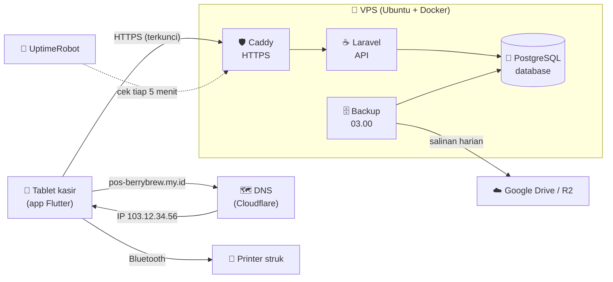
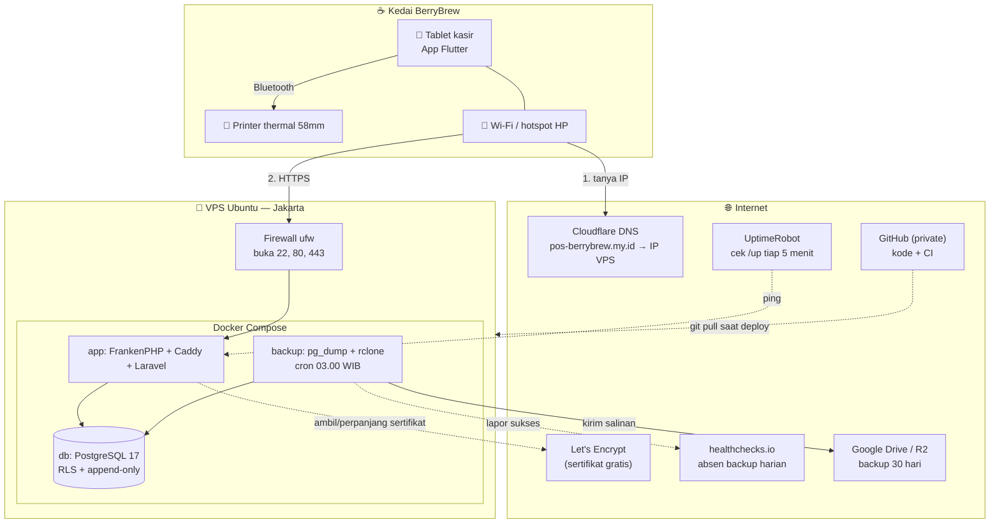
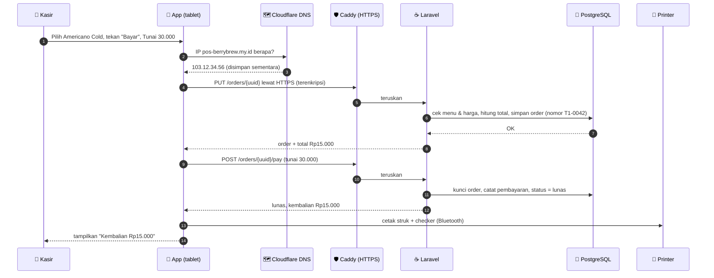
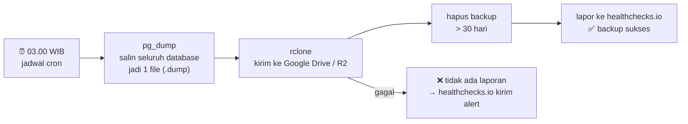
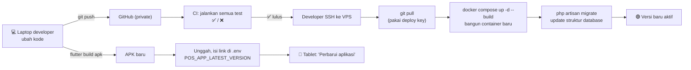
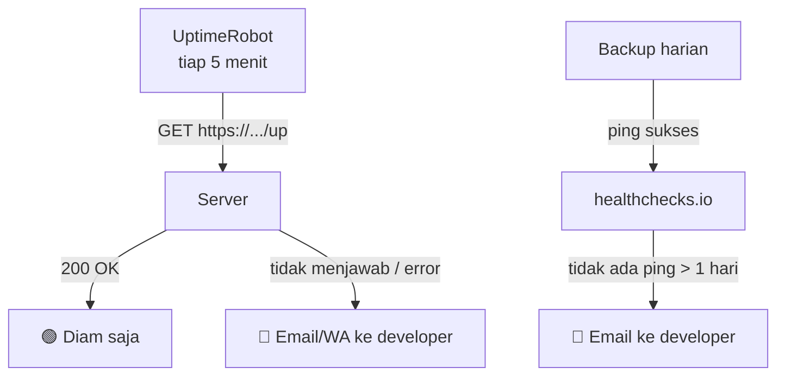
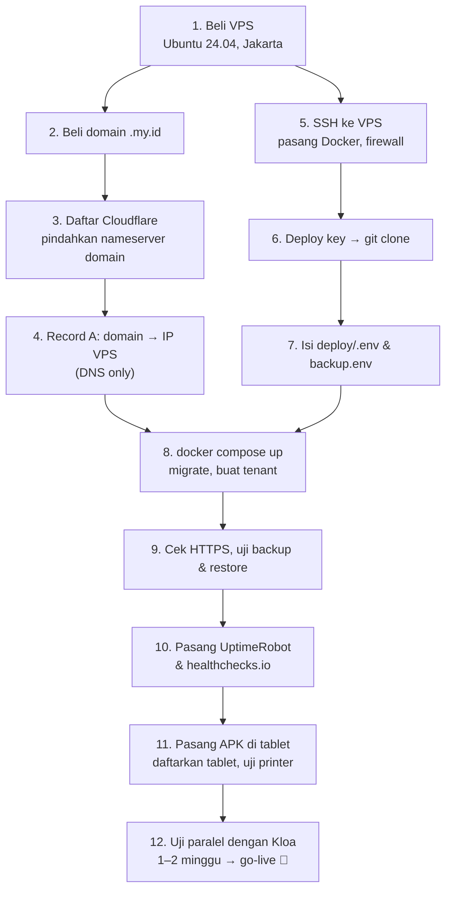

# Panduan Infrastruktur Strukasir — Dari Nol

Dokumen ini menjelaskan **semua istilah "server-server-an"** yang dipakai Strukasir: VPS, hosting,
domain, DNS, Cloudflare, HTTPS, database, Docker, backup, R2/Google Drive, monitoring, sampai alur
lengkapnya. Bahasanya sederhana, dengan analogi **kedai kopi**.

Di bagian akhir ada **prompt untuk Gemini**: satu gambar per topik, plus gambar gabungan seluruh alur.

> Diagram di dokumen ini memakai Mermaid. Diagramnya tampil otomatis di GitHub, VS Code
> (extension *Markdown Preview Mermaid Support*), atau di https://mermaid.live (tempel kodenya).

---

## Daftar isi

1. [Gambaran besar dalam satu analogi](#1-gambaran-besar-dalam-satu-analogi)
2. [Kamus istilah](#2-kamus-istilah)
3. [Arsitektur Strukasir](#3-arsitektur-strukasir)
4. [Alur 1 — Kasir menekan "Bayar"](#4-alur-1--kasir-menekan-bayar)
5. [Alur 2 — Backup otomatis jam 03.00](#5-alur-2--backup-otomatis-jam-0300)
6. [Alur 3 — Deploy & update aplikasi](#6-alur-3--deploy--update-aplikasi)
7. [Alur 4 — Monitoring: tahu sebelum owner komplain](#7-alur-4--monitoring-tahu-sebelum-owner-komplain)
8. [Kalau ada yang rusak, apa yang terjadi?](#8-kalau-ada-yang-rusak-apa-yang-terjadi)
9. [Biaya & siapa membayar apa](#9-biaya--siapa-membayar-apa)
10. [Urutan setup dari nol](#10-urutan-setup-dari-nol)
11. [Prompt gambar untuk Gemini](#11-prompt-gambar-untuk-gemini)

---

## 1. Gambaran besar dalam satu analogi

Bayangkan sistem kasir ini sebagai **kedai kopi cabang pusat** yang melayani pesanan dari tablet kasir:

| Dunia nyata | Di sistem Strukasir | Fungsinya |
|---|---|---|
| Kasir di depan | **App Flutter** di tablet | Tempat kasir menginput pesanan |
| Alamat kedai ("Jl. Kopi No. 1") | **Domain** (`pos-berrybrew.my.id`) | Nama yang mudah diingat |
| Google Maps yang menerjemahkan alamat ke titik lokasi | **DNS** | Menerjemahkan domain → alamat IP |
| Koordinat GPS kedai | **IP address** (mis. `103.12.34.56`) | Alamat "asli" komputer di internet |
| Bangunan ruko yang disewa | **VPS** | Komputer sewaan yang menyala 24 jam di data center |
| Satpam + pintu depan berkunci | **Caddy + HTTPS** | Menerima tamu dan memastikan percakapan tidak disadap |
| Barista yang memproses pesanan | **Laravel (backend/API)** | Logika bisnis: hitung harga, simpan order |
| Buku besar / lemari arsip | **Database (PostgreSQL)** | Tempat semua data disimpan permanen |
| Fotokopi buku besar yang dititipkan di rumah owner | **Backup** ke **Google Drive / R2** | Cadangan kalau ruko kebakaran |
| CCTV + alarm | **Monitoring** (UptimeRobot, healthchecks.io) | Memberi tahu kalau sistem mati |
| Kontainer barang standar yang siap dipindah | **Docker** | Membungkus aplikasi agar jalan sama di mana saja |
| Kunci ruko yang hanya dipegang pemilik | **SSH key** | Cara aman masuk ke VPS untuk mengurusnya |
| Pagar & gerbang | **Firewall (ufw)** | Hanya pintu tertentu yang boleh dimasuki |



---

## 2. Kamus istilah

### 2.1 Server
**Komputer yang tugasnya melayani komputer lain**, dan menyala terus 24 jam. Laptop Anda juga bisa
jadi server (seperti saat development), tapi laptop dimatikan, dibawa pulang, dan internet rumah tidak
stabil. Karena itu sistem yang dipakai kedai harus tinggal di server yang selalu hidup.

### 2.2 Hosting
**Jasa "menitipkan" aplikasi/website di server milik orang lain.** Ada beberapa jenis:

| Jenis | Analogi | Cocok untuk BerryBrew? |
|---|---|---|
| **Shared hosting** | Kamar kos: satu rumah dipakai ramai-ramai, aturan pemilik ketat | ❌ Tidak bisa menjalankan Docker & PostgreSQL |
| **VPS** (Virtual Private Server) | Ruko sewaan: bangunan sendiri, bebas diatur | ✅ **Dipilih** |
| **Dedicated server** | Beli/sewa gedung utuh | ❌ Terlalu mahal untuk satu kedai |
| **Cloud besar** (AWS, GCP, Azure, Oracle) | Mall raksasa dengan ribuan layanan | ⚠️ Bisa, tapi butuh kartu kredit & lebih rumit |

### 2.3 VPS (Virtual Private Server)
Satu komputer fisik besar di data center **dibagi menjadi beberapa "komputer virtual"**. Anda menyewa
satu bagian: punya CPU, RAM, disk, dan IP publik sendiri, dan Anda bebas memasang apa saja (di proyek
ini: Ubuntu + Docker).

- **vCPU**: "otak". 1–2 vCPU cukup untuk satu kedai.
- **RAM**: "meja kerja". 2 GB cukup.
- **Disk SSD**: "lemari". 20–40 GB cukup untuk bertahun-tahun transaksi.
- **Lokasi Jakarta**: makin dekat ke kedai, makin cepat responsnya.
- **IP publik**: alamat VPS di internet, mis. `103.12.34.56`.

### 2.4 IP address
**Nomor alamat setiap perangkat di internet**, seperti nomor telepon. Komputer berkomunikasi lewat IP,
bukan lewat nama. Masalahnya, IP sulit diingat dan bisa berubah kalau pindah VPS. Karena itu ada domain.

### 2.5 Domain
**Nama yang mudah diingat** untuk menggantikan IP, mis. `pos-berrybrew.my.id`.

- `.my.id` = domain Indonesia untuk perorangan. Murah (puluhan ribu rupiah per tahun) dan
  **biasanya butuh KTP** saat registrasi.
- Domain **disewa per tahun** lewat *registrar* (penjual domain). **Jangan lupa perpanjang**:
  kalau domain kedaluwarsa, app tidak bisa terhubung ke server walaupun server sehat.
- **Subdomain**: bagian depan domain, mis. `pos.berrybrew.my.id`. Satu domain bisa punya banyak
  subdomain.

### 2.6 DNS (Domain Name System)
**"Buku telepon" internet** yang menerjemahkan domain → IP.

Saat tablet membuka `pos-berrybrew.my.id`, tablet bertanya ke DNS: *"IP-nya berapa?"*. DNS menjawab
`103.12.34.56`, lalu tablet menghubungi IP itu. Isi buku telepon ini disebut **record**:

| Record | Arti | Contoh di proyek ini |
|---|---|---|
| **A** | domain → IP (IPv4) | `pos-berrybrew.my.id → 103.12.34.56` |
| **AAAA** | domain → IP (IPv6) | (opsional) |
| **CNAME** | domain → domain lain (alias) | tidak dipakai |
| **NS** (nameserver) | "siapa yang memegang buku telepon domain ini" | diarahkan ke Cloudflare |

Perubahan DNS bisa butuh beberapa menit sampai beberapa jam untuk menyebar ke seluruh internet
(*propagasi*).

### 2.7 Cloudflare
Perusahaan internet yang menyediakan banyak layanan. Yang dipakai di proyek ini:

1. **DNS gratis**: mengelola record domain dengan panel yang mudah. Caranya: di registrar domain,
   ganti *nameserver* ke milik Cloudflare.
2. **(Opsional) R2**: penyimpanan file untuk backup (lihat 2.13).

Cloudflare juga bisa menjadi **proxy** (ikon awan oranye), yaitu "perantara" di depan server. Untuk
proyek ini, proxy **dimatikan** (ikon awan abu-abu, *DNS only*) supaya Caddy di VPS bisa mengurus
sertifikat HTTPS sendiri. Ini bisa diaktifkan kemudian setelah semuanya stabil.

### 2.8 HTTP, HTTPS, SSL/TLS, sertifikat
- **HTTP**: cara app dan server "bercakap". Tanpa pengaman, percakapannya bisa dibaca orang di jaringan
  yang sama (mis. Wi-Fi kedai).
- **HTTPS**: HTTP yang **dienkripsi** (dikunci). Wajib, karena yang dikirim berisi token login dan data
  transaksi.
- **SSL/TLS**: teknologi penguncinya.
- **Sertifikat**: "KTP" server yang membuktikan bahwa `pos-berrybrew.my.id` benar-benar server Anda.
  Diterbitkan gratis oleh **Let's Encrypt** dan diperpanjang otomatis oleh **Caddy**.
- **HSTS**: aturan yang menyuruh perangkat "selalu pakai HTTPS untuk domain ini, jangan pernah HTTP".

### 2.9 Caddy & FrankenPHP (web server)
**"Satpam + resepsionis" di pintu VPS.** Caddy menerima semua koneksi dari internet, mengurus HTTPS
(termasuk menerbitkan dan memperpanjang sertifikat), mengalihkan HTTP → HTTPS, lalu meneruskan
permintaan ke aplikasi. **FrankenPHP** adalah Caddy yang sudah menyatu dengan PHP, sehingga bisa
langsung menjalankan Laravel.

### 2.10 Backend / API (Laravel)
**"Dapur" sistem.** App di tablet tidak menyimpan kebenaran harga dan transaksi. App bertanya dan
mengirim ke backend lewat **API**, yaitu "jendela pesanan" dengan aturan baku, mis.
`PUT /api/v1/orders/{id}` untuk menyimpan order dan `POST /api/v1/orders/{id}/pay` untuk membayar.
Backend menghitung ulang harga, memeriksa izin, lalu menyimpan ke database.

### 2.11 Database (PostgreSQL)
**Lemari arsip terstruktur** tempat semua data disimpan permanen: menu, user, order, pembayaran, shift,
audit log. Datanya berupa tabel (baris & kolom), mirip spreadsheet tapi jauh lebih kuat dan aman.

Pengaman yang sudah dipasang di database proyek ini:
- **Row-Level Security (RLS)**: setiap kedai hanya bisa melihat datanya sendiri, walaupun satu
  database dipakai banyak kedai.
- **Append-only**: data pembayaran dan audit log tidak bisa diubah atau dihapus. Koreksi selalu
  berupa baris baru.

Database **tidak dibuka ke internet**. Hanya aplikasi di dalam VPS yang bisa mengaksesnya.

### 2.12 Docker & container
**Kontainer pengiriman standar untuk aplikasi.** Setiap bagian sistem dibungkus dalam satu
*container* yang berisi semua kebutuhannya, sehingga jalan sama persis di laptop maupun di VPS.

Di VPS ada **3 container** (diatur oleh file `deploy/docker-compose.prod.yml`):

| Container | Isi | Tugas |
|---|---|---|
| `app` | FrankenPHP (Caddy + PHP) + Laravel | Menerima request, HTTPS, logika bisnis |
| `db` | PostgreSQL 17 | Menyimpan data |
| `backup` | pg_dump + rclone + jadwal cron | Backup harian ke luar server |

**Docker Compose** = "daftar isi" yang menyalakan ketiga container sekaligus dengan satu perintah.

### 2.13 Backup, object storage, R2, Google Drive
- **Backup**: salinan database. Dibuat otomatis **setiap hari jam 03.00 WIB**, disimpan **30 hari**.
- **Kenapa disimpan di luar VPS?** Kalau VPS rusak, terhapus, atau penyedianya bermasalah, backup yang
  ada di VPS yang sama ikut hilang. Prinsipnya: *jangan simpan fotokopi buku besar di ruko yang sama*.
- **Object storage**: layanan penyimpanan file di cloud.
  - **Google Drive**: gratis 15 GB, tidak butuh kartu kredit. **Pilihan utama.**
  - **Cloudflare R2**: gratis 10 GB, tapi aktivasinya butuh kartu/PayPal.
- **rclone**: alat yang mengirim file backup ke Google Drive/R2.
- **Restore**: proses mengembalikan data dari backup. **Backup yang belum pernah dicoba di-restore
  belum bisa dipercaya**, sehingga uji restore wajib dilakukan.

### 2.14 SSH & SSH key
**Cara masuk ke VPS dari jauh untuk mengurusnya** lewat terminal (memasang Docker, deploy, melihat log).

- **SSH key** = pasangan "gembok + kunci" digital. Gembok (*public key*) dipasang di VPS, sedangkan
  kunci (*private key*) tetap di laptop Anda. Ini jauh lebih aman daripada password.
- **Deploy key**: SSH key khusus agar VPS bisa mengunduh kode dari repo GitHub yang *private*, dengan
  akses baca saja.

### 2.15 Firewall (ufw)
**Pagar VPS.** Hanya pintu yang perlu yang dibuka: **22** (SSH), **80** (HTTP, langsung dialihkan ke
HTTPS), dan **443** (HTTPS). Pintu database (5432) tetap tertutup dari luar.

### 2.16 Port
"Nomor pintu" di satu IP. Satu VPS bisa menjalankan banyak layanan di pintu berbeda.
`443` = pintu HTTPS, `22` = pintu SSH.

### 2.17 Monitoring
- **UptimeRobot** (gratis): membuka `https://pos-berrybrew.my.id/up` setiap 5 menit. Kalau tidak
  menjawab, Anda dikirimi email/WA. Analogi: **CCTV** yang menelepon kalau kedai tutup mendadak.
- **healthchecks.io** (gratis): menunggu "laporan" dari backup setiap hari. Kalau satu hari tidak ada
  laporan, berarti backup gagal dan Anda diberi tahu. Analogi: **satpam yang wajib absen**; kalau
  tidak absen, ada yang salah.

### 2.18 Environment variable & `.env`
**Catatan rahasia & pengaturan** di server: password database, kunci aplikasi (`APP_KEY`), token
backup, dll. Disimpan di file `deploy/.env` dan `deploy/backup.env` **hanya di VPS**, tidak pernah
masuk ke GitHub.

### 2.19 Git, GitHub, CI
- **Git/GitHub**: tempat menyimpan seluruh kode beserta riwayat perubahannya.
- **CI (GitHub Actions)**: "QC otomatis". Setiap kali kode dikirim ke GitHub, semua test dijalankan.
  Kalau ada yang rusak, ketahuan sebelum masuk ke server.

### 2.20 APK
**File installer app Android.** Dibuat dari kode Flutter, lalu dipasang di tablet kasir. Setiap update
app = APK baru dengan nomor versi lebih tinggi. APK harus **ditandatangani dengan keystore yang sama**;
kalau keystore hilang, app tidak bisa di-update dan harus dipasang ulang dari awal.

---

## 3. Arsitektur Strukasir



**Yang terjadi di mana:**
- **Di tablet**: tampilan, keranjang, perhitungan harga sementara, dan **cetak struk** (langsung lewat
  Bluetooth, tidak lewat internet).
- **Di VPS**: kebenaran data. Harga dihitung ulang, pembayaran dicatat, laporan dibuat.
- **Di luar VPS**: DNS, sertifikat, backup, monitoring, dan kode.

---

## 4. Alur 1 — Kasir menekan "Bayar"



**Kenapa aman kalau internet putus di tengah jalan?** Setiap order & pembayaran punya ID unik yang
dibuat tablet. Kalau kasir menekan "Bayar" lagi, server mengenali ID yang sama dan **tidak mencatat
dobel**.

---

## 5. Alur 2 — Backup otomatis jam 03.00



**Restore (memulihkan)**: file backup diunduh lalu dimasukkan ke **database terpisah** dulu
(`berrybrew_restore_test`) untuk dicek. Database utama hanya ditimpa kalau benar-benar bencana, dan
itu butuh konfirmasi eksplisit (`CONFIRM=yes`).

---

## 6. Alur 3 — Deploy & update aplikasi



---

## 7. Alur 4 — Monitoring: tahu sebelum owner komplain



---

## 8. Kalau ada yang rusak, apa yang terjadi?

| Kejadian | Dampak ke kedai | Yang dilakukan |
|---|---|---|
| **Internet kedai mati** | Menu tetap tampil; **pembayaran perlu internet** | Nyalakan hotspot HP. Tekan "Bayar" lagi aman (tidak dobel) |
| **Printer bermasalah** | Transaksi **tetap tersimpan** | Cetak ulang dari Riwayat |
| **VPS mati / restart** | App tidak bisa transaksi sampai VPS hidup | Container otomatis menyala lagi (`restart: unless-stopped`). UptimeRobot memberi tahu developer |
| **Database rusak / terhapus** | Data hilang dari server | Restore dari backup terakhir (maks. data 1 hari hilang) |
| **Penyedia VPS bangkrut / tutup** | Server hilang total | Sewa VPS baru → deploy → restore backup dari Google Drive/R2 |
| **Domain lupa diperpanjang** | App tidak bisa menemukan server | Perpanjang domain. Pasang pengingat tahunan |
| **Keystore APK hilang** | App tidak bisa di-update | Pasang ulang app dari awal (simpan keystore di password manager!) |
| **Laptop developer hilang** | Tidak berdampak ke kedai | Kode ada di GitHub, rahasia di password manager |

---

## 9. Biaya & siapa membayar apa

| Komponen | Perkiraan biaya | Dibayar dengan | Catatan |
|---|---|---|---|
| VPS (1–2 vCPU, 2 GB RAM, Jakarta) | ± Rp50–150 ribu/bulan | Transfer bank / VA / QRIS / e-wallet | Biaya utama; masuk ke harga ke klien |
| Domain `.my.id` | ± puluhan ribu/tahun | Transfer / VA | Perlu KTP saat daftar; pasang pengingat perpanjangan |
| Cloudflare DNS | Gratis | — | |
| Sertifikat HTTPS (Let's Encrypt) | Gratis | — | Diurus otomatis oleh Caddy |
| Backup Google Drive | Gratis (15 GB) | — | Backup ± 100 KB/hari, kuota aman bertahun-tahun |
| UptimeRobot & healthchecks.io | Gratis | — | |
| GitHub private repo | Gratis | — | |

Cek harga terbaru di situs masing-masing penyedia; angka di atas hanya gambaran.

---

## 10. Urutan setup dari nol



Detail perintah setiap langkah ada di [docs/deploy.md](deploy.md).

---

## 11. Prompt gambar untuk Gemini

### Cara pakai
1. Buka Gemini, lalu salin **"Gaya dasar"** + **satu prompt** di bawahnya (gabung jadi satu pesan).
2. Generate per gambar. Kalau hasilnya kurang pas, minta revisi spesifik, mis. *"buat lebih sederhana"*
   atau *"perbesar ikon server"*.
3. Model gambar sering salah mengeja teks. Label dibuat pendek (1–3 kata). Kalau tetap salah eja,
   tambahkan label sendiri di Canva/PowerPoint.

### Gaya dasar (tempel di awal setiap prompt)

```
Style: clean flat isometric illustration, friendly and educational, like a modern infographic. Warm coffee-shop color palette: espresso brown (#6D4C41), cream (#FFF3E0), latte beige, with teal (#26A69A) accents for "internet/cloud" elements and green for "OK/secure" states. Soft shadows, rounded shapes, white background, generous spacing. Minimal text: only short labels of 1-3 words, spelled exactly as written in quotes. No brand logos. 16:9 landscape, high resolution.
```

### A. Gambar per topik

**1. Server**
```
Illustrate the concept of a "server": a friendly computer tower that never sleeps (small moon and sun icons showing 24 hours), serving coffee-cup-shaped data packets to several small tablets and phones around it, like a barista serving customers. Label the tower "Server" and the devices "Clients".
```

**2. Jenis hosting (shared vs VPS vs dedicated vs cloud)**
```
Four side-by-side scenes comparing hosting types as buildings: (1) a crowded boarding house with many small rooms labeled "Shared Hosting", (2) a single rented shophouse (ruko) with its own door and key labeled "VPS" highlighted with a green checkmark, (3) a whole large building labeled "Dedicated", (4) a giant shopping mall with many shops labeled "Cloud". Small price-tag icons under each, from cheap to expensive.
```

**3. VPS**
```
One huge physical server machine inside a data center, cut open to show it divided into 4 separate glowing virtual rooms. One room is highlighted as "Our VPS" and contains small icons for CPU (brain), RAM (desk), SSD (cabinet) and a door with a number plate "Public IP". A small Indonesia map pin labeled "Jakarta" on the data center.
```

**4. IP address**
```
Visualize an IP address as a house number / phone number for computers: several computers on a city map, each with a numeric address plate like "103.12.34.56". A delivery courier with a parcel finds the correct house using the number. Label "IP Address".
```

**5. Domain**
```
A shop sign reading "pos-berrybrew.my.id" hanging in front of a coffee shop, next to a hard-to-remember numeric plate "103.12.34.56" that is crossed out softly. A calendar icon with "1 year" showing the domain is rented yearly. Label "Domain".
```

**6. DNS**
```
Show DNS as a phone book or map app: a tablet asks a big friendly phone-book character "Where is pos-berrybrew.my.id?" and the phone book points to a server with the number "103.12.34.56". Show it as a 3-step flow with arrows: ask, answer, connect. Label "DNS".
```

**7. Cloudflare**
```
A friendly orange cloud acting as a reception desk that manages a large address book of domain records (rows labeled "A", "NS"). One record line connects the domain sign to a server. A small toggle switch next to the cloud shows "DNS only" in grey. Label "Cloudflare".
```

**8. HTTPS & sertifikat**
```
Two scenes side by side: left, a tablet sending a postcard that a sneaky figure can read, labeled "HTTP"; right, the same tablet sending a locked steel box with a padlock through a tunnel, labeled "HTTPS". Above the right scene, a certificate document with a ribbon seal labeled "SSL Certificate" handed over by a small robot labeled "Let's Encrypt".
```

**9. Caddy (web server)**
```
A security guard / receptionist character standing at the glass door of a modern shophouse, checking visitors and putting a padlock on every message, then passing orders to a kitchen behind. The guard wears a badge "Caddy". Arrows: "Internet" on the outside, "App" on the inside.
```

**10. Backend / API**
```
A coffee shop service window: tablets outside slide order tickets through a small window labeled "API", and inside a barista robot labeled "Laravel" checks the price list, calculates the total on a calculator, and writes it into a big ledger book. Clean kitchen scene.
```

**11. Database**
```
A large organized archive room with labeled cabinets "Menu", "Orders", "Payments", "Shifts". Each drawer holds neat table-like cards. One cabinet "Payments" has a lock icon and a stamp "No Edit" (append-only). Separate colored sections show each coffee shop can only open its own drawer. Label "Database".
```

**12. Docker & container**
```
A rented shophouse (VPS) with three standardized shipping containers inside, each a different color and labeled "app", "db", "backup". A conductor character holding a sheet labeled "Compose" starts all three at once with one button. Show the same three containers on a laptop on the side to express "runs the same everywhere".
```

**13. Backup & restore**
```
A clock showing 03:00 at night, a machine photocopying a big ledger book, and a courier carrying the copy out of the building to a cloud storage vault labeled "Google Drive". A calendar strip shows "30 days" of copies. On the right side, a reverse arrow labeled "Restore" brings a copy back into a fresh test cabinet.
```

**14. SSH & firewall**
```
A developer at a laptop holding a unique golden key labeled "SSH key" that fits only one padlock on the back door of a shophouse server. The building is surrounded by a fence labeled "Firewall" with only three open gates numbered "22", "80", "443". The database room inside has no outside door.
```

**15. Monitoring**
```
A CCTV camera labeled "UptimeRobot" pointing at a server building, checking every 5 minutes (small clock), and a security guard with a clipboard labeled "healthchecks" waiting for a daily check-in from a backup robot. When something fails, a phone on the side lights up with a red alert notification.
```

**16. Deploy & update**
```
A conveyor-belt pipeline from left to right: a laptop "Code" → GitHub-like box "Repo" → quality inspector with checklist "Tests" → truck arriving at a shophouse server "Deploy" → green light "Live". Under it a smaller lane: phone app package "APK" → tablet showing "Update".
```

### B. Gambar gabungan

**17. Peta besar seluruh sistem**
```
One complete isometric map of the whole system, organized in three zones from left to right:

ZONE 1 "Coffee Shop": a cozy coffee counter with a cashier, a landscape tablet running a POS app, a small thermal receipt printer connected by a dotted Bluetooth line, and a Wi-Fi router.

ZONE 2 "Internet": an orange cloud labeled "Cloudflare DNS", a robot handing a certificate labeled "Let's Encrypt", a CCTV camera labeled "UptimeRobot", a cloud vault labeled "Google Drive" receiving backup copies, and a code box labeled "GitHub".

ZONE 3 "VPS Jakarta": a rented shophouse building surrounded by a fence with gates "22", "80", "443". Inside, three containers: "app" (with a padlock and a barista robot), "db" (archive cabinets), and "backup" (a photocopier with a 03:00 clock).

Draw clear numbered arrows: (1) tablet asks Cloudflare for the address, (2) tablet sends a locked box (HTTPS) to the shophouse, (3) app stores data in db, (4) receipt prints back at the coffee shop, (5) backup container sends a copy to Google Drive at night, (6) UptimeRobot checks the server. Keep it readable like a poster, with lots of white space.
```

**18. Alur "Kasir menekan Bayar" (komik 6 panel)**
```
A 6-panel comic strip, same flat coffee-shop style:
1) A cashier taps "Bayar" on a tablet with an Americano order.
2) The tablet asks a phone-book character for the server address.
3) A locked box travels through a tunnel to a shophouse server.
4) A barista robot checks prices and writes in a ledger "T1-0042".
5) A thumbs-up message returns to the tablet showing change "Rp15.000".
6) A small printer prints a receipt while the customer smiles.
Short captions only: "Bayar", "Cari alamat", "HTTPS", "Simpan", "Lunas", "Cetak".
```

**19. Alur keselamatan data (backup & bencana)**
```
A 3-step story poster: (1) night scene at 03:00, the server photocopies its ledger and a courier carries it to a cloud vault "Google Drive"; (2) disaster scene, the shophouse server is broken with smoke; (3) recovery scene, a new shophouse server receives the copy back from the cloud vault and the coffee shop tablet is working again with a green check. Captions: "Backup", "Rusak", "Pulih".
```
